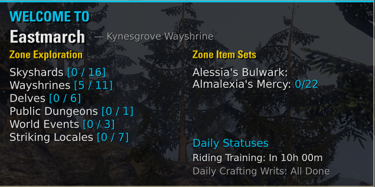
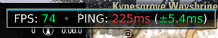
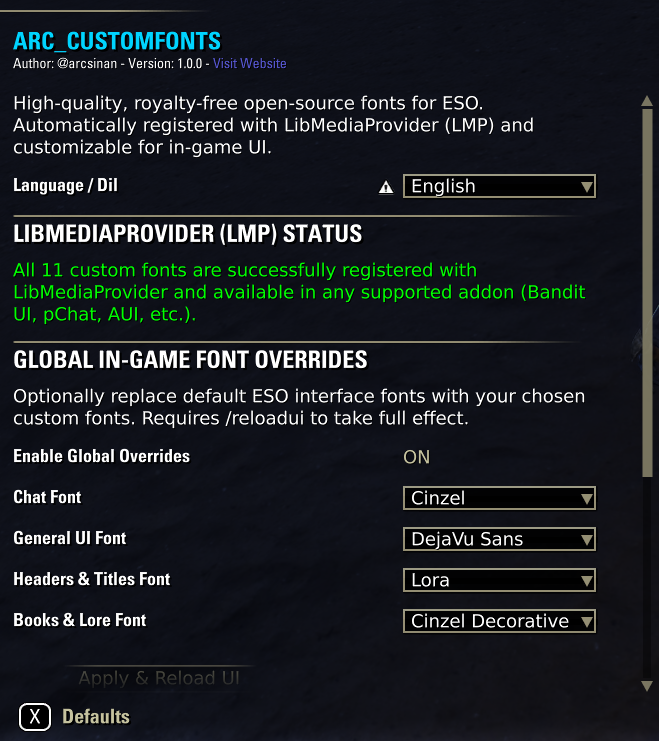

# ESO_Addons

A collection of quality-of-life (QoL) user interface addons and companion automation utilities for *The Elder Scrolls Online* (ESO), developed and maintained by **@arcsinan** ([GitHub](https://github.com/sinanyuzgulec)).

---

## 📦 Projects

### 1. [ARC_ZoneExplorer](./ARC_ZoneExplorer) 

  

* **Category**: In-Game UI Addon
* **ESOUI Download**: [info4972-ARC_ZoneExplorer](https://www.esoui.com/downloads/info4972-ARC_ZoneExplorer-ZoneArrivalampExplorationHUD.html)
* **Compatibility**: Elder Scrolls Online (Update 44 / Gold Road ready, API `101050 101051`)
* **Key Features**:
  - Displays an elegant arrival summary and exploration HUD when loading into a new zone or city.
  - Tracks real-time Zone Guide completion (Skyshards, Wayshrines, Delves, Dungeons, World Bosses, Events, Locales, Story Quests).
  - Displays overland Item Set Collection (Stickerbook) unlock progress.
  - Tracks character daily reminders: Riding training cooldown and active Crafting Writs.
  - Flexible display modes: Standard 2-column view and auto-sizing Compact Mini Card view.
  - Granular toggles to show/hide individual activities, hide 100% completed tasks, and adjust UI scale (50%–130%).
  - Full localization in **English** (default) and **Turkish** (`Türkçe`).
  - Required: `LibAddonMenu-2.0>=43`. Optional: `LibSets`.

### 2. [ARC_NetGraph](./ARC_NetGraph) 

  

* **Category**: In-Game UI Addon
* **ESOUI Download**: [info4973-ARC_NetGraph](https://www.esoui.com/downloads/info4973-ARC_NetGraphr-Real-TimeNetworkTelemetryampFPS.html)
* **Compatibility**: Elder Scrolls Online (Update 44 / Gold Road ready, API `101050 101051`)
* **Key Features**:
  - Lightweight, real-time network telemetry and performance HUD.
  - Displays **Ping** (round-trip server latency in ms), **Jitter** (RFC 3550 packet arrival variance), **Min/Max Spikes**, and **FPS**.
  - Dynamic health color coding (Green = Great, Yellow = Moderate, Red = Unstable/High).
  - 3 flexible layouts: **Compact Bar** (Single Line), **Detailed Card** (Auto-sizing Grid), and **Minimalist** (Badge).
  - Position lock toggle (click-through mode) preventing accidental dragging during combat.
  - Full localization in **English** (default) and **Turkish** (`Türkçe`).
  - Required: `LibAddonMenu-2.0>=43`.

### 3. [ARC_SetGlowGuard](./ARC_SetGlowGuard) 

  

* **Category**: In-Game UI Addon
* **ESOUI Download**: [info4970-ARC_SetGlowGuard](https://www.esoui.com/downloads/info4970-ARC_SetGlowGuard-SetGlowampEquipmentTracker.html)
* **Compatibility**: Elder Scrolls Online (Update 44 / Gold Road ready, API `101050 101051`)
* **Key Features**:
  - Automatically identifies all equipped armor, weapons, and jewelry sets.
  - Highlights worn sets with coordinated vibrant glow colors (Cyan, Amber, Neon Purple, Emerald, Coral, Orange, and special Mythic glow).
  - Automatically docks the Character equipment panel next to your backpack when opening inventory (`I`).
  - Highlights matching unequipped set pieces in your backpack with identical colors and a vertical accent bar, preventing accidental unequip or set breakage.
  - Shows clear incomplete set alerts on gear slots (e.g., `4/5` or `1/2`).
  - Full localization in **English** (default) and **Turkish** (`Türkçe`).
  - Required: `LibAddonMenu-2.0>=43`.

### 4. [ARC_CustomFonts](./ARC_CustomFonts) 

  

* **Category**: In-Game Typography & Font Library Addon
* **ESOUI Download**: [info4971-ARC_CustomFonts](https://www.esoui.com/downloads/info4971-ARC_CustomFonts-High-QualityOpen-SourceFonts.html)
* **Compatibility**: Elder Scrolls Online (Update 44 / Gold Road ready, API `101050 101051`)
* **Key Features**:
  - Curated collection of 11 open-source, SIL OFL licensed typefaces converted into native Update 41+ Slug font format (`.slug`) and `.ttf`.
  - Full Unicode support for Turkish diacritics (`ç, ğ, ı, İ, ö, ş, ü`).
  - Registers fonts seamlessly with `LibMediaProvider-1.0` for use in any compatible addon (Bandits UI, AUI, Azurah, etc.).
  - Includes fonts such as Cinzel, MedievalSharp, Inter, Outfit, Lora, Bebas Neue, DejaVu Sans, and Turkish Font.
  - Required: `LibAddonMenu-2.0>=43`, `LibMediaProvider-1.0>=34`.

### 5. [ARC_TTC_PriceTable_python_workaround](./ARC_TTC_PriceTable_python_workaround)
* **Category**: External Automation Companion Tool (CLI & Daemon)
* **Target Platforms**: Linux (Steam Deck, Proton, Lutris), macOS, and Windows
* **Key Features**:
  - Automatically downloads and extracts official Tamriel Trade Centre (TTC) price table data (`PriceTableEU.lua` / `PriceTableNA.lua`).
  - Completely eliminates the need for the official Windows `.NET Client.exe` on Linux and macOS.
  - Zero third-party Python dependencies (built entirely on the Python 3 standard library).
  - Background daemon support via `systemd --user` (Linux), `launchd` (macOS), or Windows Task Scheduler.

### 6. [ARC_TurkishLanguageSupport](./ARC_TurkishLanguageSupport)
* **Category**: In-Game Localization Addon
* **Status**: 🚧 **Work in Progress / Geliştirme Aşamasında (İlerleme: ~%1)**
* **Compatibility**: Elder Scrolls Online (API `101050 101051`)
* **Key Features**:
  - Full Unicode TrueType font replacement ensuring clean rendering of Turkish characters (`ç, ğ, ı, İ, ö, ş, ü`).
  - Modular localization architecture (UI & Menus, Skills & Abilities, Items & Traits, Quests & Journal, Dialogues & Interactions).
  - Granular toggle controls for every module via `LibAddonMenu-2.0`.
  - Slash command diagnostics (`/tls` or `/turkce`).

---

## 📄 License

All projects in this repository are open source and licensed under the [MIT License](https://opensource.org/licenses/MIT).
